<div align="center">



<br/>


*there is a number that isn't one.*
*there is an operation that isn't allowed.*
*you have been asked to put them together.*


</div>

<br/>

## `> transcript`

<div align="center">
 what is it / yes" width="100%"/>
</div>

<details>
<summary><sub>▓ raw terminal render (no JS, no SVG, no mercy)</sub></summary>

```
 ███╗   ██╗ █████╗ ███╗   ██╗      ╱    ██████╗
 ████╗  ██║██╔══██╗████╗  ██║     ╱    ██╔═████╗
 ██╔██╗ ██║███████║██╔██╗ ██║    ╱     ██║██╔██║
 ██║╚██╗██║██╔══██║██║╚██╗██║   ╱      ████╔╝██║
 ██║ ╚████║██║  ██║██║ ╚████║  ╱       ╚██████╔╝
 ╚═╝  ╚═══╝╚═╝  ╚═╝╚═╝  ╚═══╝ ╱         ╚═════╝
```

</details>

<div align="center"></div>

## `> manifest`

```diff
+ 1
+ 2
+ 3
- 4
- ·
- ·
! 4095
```

```
ff 00 00 00 00 08 f8 7f
```

Read it backwards. Then read it as nothing.

<div align="center"></div>

## `> intercepted`

> *"bits 8–34 are reserved and must be zero."*
>
> *"undefined opcodes must trap."*
>
> *"do not use floating-point arithmetic."*

Three sentences. One entire worldview. We will not elaborate.

<div align="center"></div>

## `> signal`

Thirteen words fell out of the build. Each one is a quiet NaN. None of them is an error.

```
7ff8002000000043
7ff8005800000030
7ff8006800000035
7ff800400000004e
7ff8005000000034
7ff800280000004b
7ff8006000000039
7ff8004800000020
7ff800100000004e
7ff800080000004b
7ff800380000004f
7ff800180000004f
7ff8003000000020
```

- no checksum
- no key
- the order is in the machine
- the message is in the rest

First to decode it, open an issue titled with what it says. We will neither confirm nor deny. We will *notice*.

<div align="center"></div>

## `> pieces on the table`

| | |
|:-:|---|
| 🟣 | `██████████` |
| 🟢 | `x != x` |
| 🔵 | `███ ██ ████` |
| 🟡 | a thing that reads itself |
| 🟠 | a thing that refuses to |
| 🔴 | `[ ]` ← *eventually* |
| ⚫ | the quiet part |

<div align="center"></div>

## `> door`

```sh
git clone https://github.com/shemshallah/nan0
# the door is painted on.
```

⭐ if you understood any of this.
⭐⭐ if you didn't, and it bothered you.

<br/>

<div align="center">

`7ff8 ····`

**`NaN ≠ NaN`**

<sub>divide by nothing. get everything.</sub>

</div>
